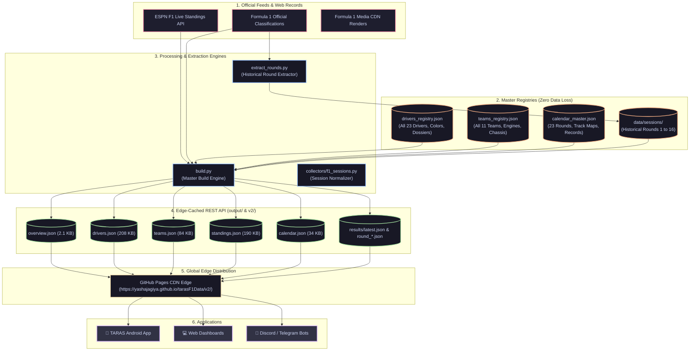

<div align="center">

# 🏎️ Taras F1 API v2
### The Free, Zero-Latency, Edge-Cached Formula 1 Public REST API & Dataset

[](https://github.com/yashajagiya/Taras/actions/workflows/update-f1.yml)
[](https://yashajagiya.github.io/Taras/v2/overview.json)
[](https://www.formula1.com)
[](https://yashajagiya.github.io/Taras/v2/overview.json)
[](https://yashajagiya.github.io/Taras/)
[](LICENSE)

<p align="center">
  <b>A world-class, 100% free, production-ready static REST API delivering Formula 1 championship standings, driver dossiers, constructor specifications, weekend session telemetry, transparent track maps, and official race results.</b>
</p>

[🌐 Live API Explorer](https://yashajagiya.github.io/Taras/) • [📑 API Reference](docs/API_REFERENCE.md) • [🏗️ Architecture Guide](docs/ARCHITECTURE.md) • [📌 Core Features](#-core-features--whats-new-in-v2) • [💻 Code Samples](#-quickstart-integration--code-samples) • [🛠️ How to Run Locally](#-how-to-run--build-locally)

---

</div>

## 📌 Core Features & What's New in v2

<table>
  <tr>
    <td width="50%">
      <h3>⚡ Edge-Delivered & Serverless</h3>
      <ul>
        <li><b>Zero Latency:</b> Edge-cached globally across GitHub's worldwide Fastly/Cloudflare CDN.</li>
        <li><b>Zero API Keys:</b> 100% open access without rate limits, quotas, or billing.</li>
        <li><b>Home in 1 Request:</b> Complete dashboard (championship leaders, next race countdown, session schedule, latest podium) in a single request.</li>
        <li><b>Interactive Portal:</b> Built-in web explorer at <a href="index.html"><code>index.html</code></a> to test and copy snippets.</li>
      </ul>
    </td>
    <td width="50%">
      <h3>🎯 100% Data Fidelity & Safety</h3>
      <ul>
        <li><b>All 23 Drivers:</b> Full profiles and standings for all 23 drivers (including Yuki Tsunoda #22 at Racing Bulls).</li>
        <li><b>Non-Destructive Results:</b> Full weekend sessions archived per round (<code>results/round_{1..18}.json</code>) without overwriting previous races!</li>
        <li><b>Deep Analytics:</b> 16-metric 2026 season stats, 8-metric career stats, track vectors, and team specs.</li>
        <li><b>Automated CI/CD:</b> GitHub Actions workflow updates data every Monday after race weekends.</li>
      </ul>
    </td>
  </tr>
</table>

---

## 🌐 The Unified v2 Endpoints

**Base URL:** `https://yashajagiya.github.io/Taras/v2/` *(or `https://yashajagiya.github.io/tarasF1Data/v2/`)*

| Endpoint | Method | Path | What It Provides | Sample Size |
|---|:---:|---|---|:---:|
| **Overview** | `GET` | [`/v2/overview.json`](v2/overview.json) | **Home screen in 1 request**: leaders, next race countdown, live schedule, latest podium. | `~2.1 KB` |
| **Drivers** | `GET` | [`/v2/drivers.json`](v2/drivers.json) | **All 23 drivers**: portraits, number vector logos, team colors, bios, 2026 stats, career stats. | `~208 KB` |
| **Teams** | `GET` | [`/v2/teams.json`](v2/teams.json) | **All 11 constructors**: car cutouts, white logos, leadership, engines, chassis, factory bases. | `~84 KB` |
| **Standings** | `GET` | [`/v2/standings.json`](v2/standings.json) | Complete leaderboards for both Drivers and Constructors with **round-by-round points**. | `~190 KB` |
| **Calendar** | `GET` | [`/v2/calendar.json`](v2/calendar.json) | Complete 24-race season with track outline maps, circuit records, corners, and UTC schedules. | `~34 KB` |
| **Active Weekend** | `GET` | [`/v2/results/latest.json`](v2/results/latest.json) | Complete classifications for active / latest weekend (FP1, FP2, FP3, Qualy, Sprint, Race). | `~26 KB` |
| **Historical Rounds** | `GET` | [`/v2/results/round_{N}.json`](v2/results/round_17.json) | Full weekend session archives for **Rounds 1 through 18** (e.g. `round_17.json`, `round_14.json`). | `~25 KB` each |
| **Live Telemetry** | `GET` | [`/v2/live.json`](v2/live.json) | Live race state, flags, on-track car count, and leader metadata. | `~0.4 KB` |

---

## 💻 Quickstart Integration & Code Samples

### 1. JavaScript / Web / React (`fetch`)

```javascript
// 🏎️ Fetch home dashboard in 1 request
const response = await fetch("https://yashajagiya.github.io/tarasF1Data/v2/overview.json");
const overview = await response.json();

console.log(`Championship Leader: ${overview.championship_leader.driver.name} (${overview.championship_leader.driver.points} pts)`);
console.log(`Team Leader:         ${overview.championship_leader.team.name} (${overview.championship_leader.team.points} pts)`);
console.log(`Next Grand Prix:     ${overview.next_event.race_name} at ${overview.next_event.circuit_name}`);

// 🏁 Fetch any past round results (e.g. Round 15 Azerbaijan)
const round15 = await fetch("https://yashajagiya.github.io/tarasF1Data/v2/results/round_15.json").then(r => r.json());
console.log(`Round 15 Winner:     ${round15.sessions.race[0].driver_name} (${round15.sessions.race[0].team})`);
```

### 2. Python (`requests`)

```python
import requests

# Fetch all 23 drivers with portraits, colors, and standings
drivers = requests.get("https://yashajagiya.github.io/tarasF1Data/v2/drivers.json").json()

print(f"{'No.':<4} {'Code':<5} {'Driver':<20} {'Team':<20} {'Points'}")
print("-" * 60)
for d in drivers:
    print(f"#{d['number']:<3} {d['code']:<5} {d['name']:<20} {d['team']['name']:<20} {d['standings']['points']:>3} pts")

# Fetch specific past round (e.g. Round 14 Spanish GP at Madrid)
r14 = requests.get("https://yashajagiya.github.io/tarasF1Data/v2/results/round_14.json").json()
print("\nRound 14 Podium Finishers:")
for pos, finisher in enumerate(r14["sessions"]["race"][:3], 1):
    print(f"  P{pos}: {finisher['driver_name']} ({finisher['team']}) - {finisher['time_or_retired']}")
```

### 3. Android Kotlin (Retrofit)

```kotlin
// Data Models
data class F1Overview(
    val season: Int,
    val round_current: Int,
    val championship_leader: ChampionshipLeader,
    val next_event: NextEvent,
    val latest_race: LatestRace
)

data class ChampionshipLeader(
    val driver: LeaderDriver,
    val team: LeaderTeam
)

data class LeaderDriver(
    val name: String,
    val number: Int,
    val team: String,
    val color_hex: String,
    val points: Int,
    val image: String
)

data class LeaderTeam(
    val name: String,
    val color_hex: String,
    val points: Int,
    val logo: String
)

data class WeekendResult(
    val round: Int,
    val race_name: String,
    val circuit_name: String,
    val status: String,
    val weekend_format: String,
    val sessions: WeekendSessions
)

data class WeekendSessions(
    val practice_1: List<PracticeEntry>?,
    val qualifying: List<QualifyingEntry>?,
    val sprint_race: List<RaceEntry>?,
    val race: List<RaceEntry>?
)

// Retrofit API Service
interface F1ApiService {
    @GET("v2/overview.json")
    suspend fun getOverview(): F1Overview

    @GET("v2/drivers.json")
    suspend fun getDrivers(): List<DriverDto>

    @GET("v2/results/latest.json")
    suspend fun getLatestWeekend(): WeekendResult

    @GET("v2/results/round_{round}.json")
    suspend fun getRoundResults(@Path("round") round: Int): WeekendResult
}
```

### 4. cURL / Shell

```bash
# Fetch Championship Overview
curl -s https://yashajagiya.github.io/tarasF1Data/v2/overview.json | jq .

# Fetch Driver Standings
curl -s https://yashajagiya.github.io/tarasF1Data/v2/standings.json | jq .drivers[0:5]

# Fetch Round 15 Azerbaijan Race Results
curl -s https://yashajagiya.github.io/tarasF1Data/v2/results/round_15.json | jq .sessions.race[0:3]
```

---

## 🏗️ System Architecture

`tarasF1Data` operates as a 100% headless, serverless data plane:



---

## 🏎️ Historical Rounds Archive (Rounds 1 to 16)

In **Taras F1 API v2**, past race results are **permanently archived and preserved** in dedicated documents instead of being overwritten after each race:

| Round | Grand Prix | Circuit | Weekend Format | Winner | Endpoint |
|:---:|:---|:---|:---:|:---|:---:|
| **01** | Australian Grand Prix | Albert Park Circuit | Conventional | George Russell | [`round_1.json`](https://yashajagiya.github.io/tarasF1Data/v2/results/round_1.json) |
| **02** | Chinese Grand Prix | Shanghai International Circuit | **Sprint** | Kimi Antonelli | [`round_2.json`](https://yashajagiya.github.io/tarasF1Data/v2/results/round_2.json) |
| **03** | Japanese Grand Prix | Suzuka Racing Course | Conventional | Kimi Antonelli | [`round_3.json`](https://yashajagiya.github.io/tarasF1Data/v2/results/round_3.json) |
| **04** | Miami Grand Prix | Miami International Autodrome | **Sprint** | Kimi Antonelli | [`round_4.json`](https://yashajagiya.github.io/tarasF1Data/v2/results/round_4.json) |
| **05** | Canadian Grand Prix | Circuit Gilles-Villeneuve | **Sprint** | Kimi Antonelli | [`round_5.json`](https://yashajagiya.github.io/tarasF1Data/v2/results/round_5.json) |
| **06** | Monaco Grand Prix | Circuit de Monaco | Conventional | Kimi Antonelli | [`round_6.json`](https://yashajagiya.github.io/tarasF1Data/v2/results/round_6.json) |
| **07** | Spanish Grand Prix | Circuit de Barcelona-Catalunya | Conventional | Lewis Hamilton | [`round_7.json`](https://yashajagiya.github.io/tarasF1Data/v2/results/round_7.json) |
| **08** | Austrian Grand Prix | Red Bull Ring | Conventional | George Russell | [`round_8.json`](https://yashajagiya.github.io/tarasF1Data/v2/results/round_8.json) |
| **09** | British Grand Prix | Silverstone Circuit | **Sprint** | Charles Leclerc | [`round_9.json`](https://yashajagiya.github.io/tarasF1Data/v2/results/round_9.json) |
| **10** | Belgian Grand Prix | Circuit de Spa-Francorchamps | Conventional | Kimi Antonelli | [`round_10.json`](https://yashajagiya.github.io/tarasF1Data/v2/results/round_10.json) |
| **11** | Hungarian Grand Prix | Hungaroring | Conventional | Lando Norris | [`round_11.json`](https://yashajagiya.github.io/tarasF1Data/v2/results/round_11.json) |
| **12** | Dutch Grand Prix | Circuit Zandvoort | **Sprint** | Lando Norris | [`round_12.json`](https://yashajagiya.github.io/tarasF1Data/v2/results/round_12.json) |
| **13** | Italian Grand Prix | Autodromo Nazionale Monza | Conventional | Kimi Antonelli | [`round_13.json`](https://yashajagiya.github.io/tarasF1Data/v2/results/round_13.json) |
| **14** | Spanish GP (Madrid) | Madring | Conventional | Kimi Antonelli | [`round_14.json`](https://yashajagiya.github.io/tarasF1Data/v2/results/round_14.json) |
| **15** | Azerbaijan Grand Prix | Baku City Circuit | Conventional | George Russell | [`round_15.json`](https://yashajagiya.github.io/tarasF1Data/v2/results/round_15.json) |
| **16** | Bahrain GP in Malaysia | Sepang International Circuit | Conventional | Max Verstappen | [`round_16.json`](https://yashajagiya.github.io/tarasF1Data/v2/results/round_16.json) |

---

## 🛠️ Historical Round Extractor Engine

The repository includes a dedicated CLI tool to extract and archive past rounds on demand:

```bash
# Extract all old rounds (Round 15 down to 1)
python extract_rounds.py

# Extract a specific round:
python extract_rounds.py --round 15

# Extract specific rounds:
python extract_rounds.py --rounds 15,14,13

# Re-scrape and force update:
python extract_rounds.py --all --force

# Extract and auto-rebuild the complete V2 API:
python extract_rounds.py --build
```

---

## 🔄 Migrating from v1 to v2

The legacy **v1 API** has been cleanly organized into the [`/v1`](v1/) folder. Upgrading your application to **v2** requires significantly fewer network requests and simplifies client models:

| What you did in v1 | How to do it in v2 | Benefit in v2 |
|---|---|---|
| Requesting `driversperrace.json` & `carperrace.json` separately | `GET /v2/standings.json` | 1 unified request with both Drivers & Teams + round breakdowns |
| Requesting `f1Info/drivers_data.json` | `GET /v2/drivers.json` | Full 23 drivers with team colors, portraits, 16 season metrics |
| Requesting `f1Info/teams_data.json` & `teamsimgdata.json` | `GET /v2/teams.json` | Complete constructor data, car renders, technical specs |
| Requesting 7 session files (`practice1`, `race-result`, etc.) | `GET /v2/results/latest.json` | Complete weekend classifications in 1 single JSON payload |
| Manually caching past races before they get overwritten | `GET /v2/results/round_{N}.json` | Dedicated static endpoints for every past round from Round 1 |
| Making 4+ separate calls to populate Home Dashboard | `GET /v2/overview.json` | **1 request**: leaders, countdown, schedule, latest podium |

> **Legacy Access:** If you still require the legacy v1 endpoints, they remain fully accessible under the [`/v1`](v1/) path (e.g. `https://yashajagiya.github.io/tarasF1Data/v1/driversperrace.json`). See [`v1/README.md`](v1/README.md) for details.

---

## 📂 Repository File Structure

```text
TarasAPIstatic/
├── index.html                   ← Interactive Developer Portal & REST API Explorer
├── .github/
│   └── workflows/
│       └── update-f1.yml        ← Weekly automated GitHub Actions scraper & deployer
├── v2/                          ← 100% Self-Contained Modern REST API Module
│   ├── overview.json            ← Public endpoint: Home dashboard in 1 request
│   ├── drivers.json             ← Public endpoint: All 23 drivers with portraits & stats
│   ├── teams.json               ← Public endpoint: All 11 constructors with car cutouts & logos
│   ├── standings.json           ← Public endpoint: Championship tables & round progression
│   ├── calendar.json            ← Public endpoint: 24-race schedule & track maps
│   ├── live.json                ← Public endpoint: Live race session state
│   ├── results/                 ← Session classifications (latest & round_{1..18}.json)
│   ├── build.py                 ← Master V2 Build Engine
│   ├── update.py                ← Single-command update & verify orchestrator
│   ├── extract_rounds.py        ← Historical round extractor
│   ├── test_v2_integrity.py     ← 8-suite zero data loss verification tests
│   ├── collectors/              ← Data adapters (ESPN, F1 Encyclopedia, Sessions)
│   ├── scrapers/                ← Official F1 session scrapers
│   ├── data/                    ← Organized Master Data Store:
│   │   ├── registries/          ← Drivers, teams, and calendar registries
│   │   ├── images/              ← Driver portraits, car cutouts, track maps
│   │   ├── standings/           ← Standings caches & points progression
│   │   └── sessions/            ← Raw session classifications (current/ & rounds/)
│   └── README.md
├── v1/                          ← 100% Self-Contained Legacy API Module
│   ├── driversperrace.json
│   ├── carperrace.json
│   ├── peerracepointdriver.py
│   ├── peerracepointcar.py
│   ├── f1Info/
│   ├── practice1/ ... practice3/
│   ├── qualifying/
│   ├── sprint-quly/ ... sprint-race/
│   ├── race-result/
│   └── README.md
├── docs/                        ← Complete Documentation Suite
│   ├── API_REFERENCE.md         ← Full endpoint reference & schemas
│   ├── ARCHITECTURE.md          ← Clean architecture & extension guide
│   ├── F1_DATA_SOURCES.md       ← External data sources catalog
│   ├── PROJECT.md               ← Ecosystem background & product role
│   └── mobile_app_specs/        ← Android TARAS app UI specifications
├── run_v1.py                    ← Master Async Anti-Ban Runner for V1
├── run_v2.py                    ← Master Async Anti-Ban Runner for V2
├── update_v2.py                 ← Root CLI shortcut delegating to v2/update.py
├── extract_rounds.py            ← Root CLI shortcut delegating to v2/extract_rounds.py
└── README.md                    ← You are here!
```

---

## 🚀 How to Run & Build Locally

### 1. Requirements
- Python 3.9+
- `pip install requests beautifulsoup4`

### 2. Single-File Asynchronous Anti-Ban Runners (`run_v1.py` & `run_v2.py`)
Both **V1** and **V2** include single-file asynchronous runners engineered with industrial anti-ban defenses to ensure continuous scraping does not get blocked or IP banned:

- **🛡️ Anti-Ban Architecture:**
  - **Rotating Browser Fingerprints:** Modern Chrome 125/126, Edge 125, macOS Safari, and Firefox 126 profiles with full `sec-ch-ua` and `Sec-Fetch-*` headers.
  - **Per-Domain Rate Limits:** Independent `asyncio.Lock` per domain (`formula1.com`, `espn.com`, `f1api.dev`) so parallel scraping never hammers a single host.
  - **Polite Jittered Delays:** Randomized human pauses (`1.8s - 3.8s` standard, `3.5s - 6.5s` in `--stealth`).
  - **Smart Cache Bypass:** Historical and finalized sessions skip network calls completely via cache-hit guards (`⚡ Cache Hit`).
  - **Automatic Backoff & Circuit Breaker:** Exponential backoff on HTTP 429/403, and automatic 5–10 minute safety cooldown on consecutive blocks.

#### V2 Modern REST API Runner:
```bash
# Run safely once (auto-detects active weekend & builds endpoints)
python run_v2.py

# Continuous scraping loop with polite jitter (every 5 minutes)
python run_v2.py --loop --interval 300

# Stealth mode (maximum safety delays 3.5s - 6.5s)
python run_v2.py --stealth

# Scrape specific round and push to GitHub if verified
python run_v2.py --round 17 --push

# Build endpoints without network requests
python run_v2.py --skip-scrape
```

#### V1 Legacy API Runner:
```bash
# Run all V1 pipelines once (standings, calendar, active sessions)
python run_v1.py

# Continuous scraping loop with polite jitter
python run_v1.py --loop --interval 300

# Stealth mode (maximum safety delays)
python run_v1.py --stealth

# Only update standings without touching sessions
python run_v1.py --skip-sessions
```

### 3. Verify Data Integrity
```bash
python v2/test_v2_integrity.py
```
Validates that 100% of driver fields, team specs, track maps, standings, and round session classifications are preserved without data loss.

---

## 📄 License & Attribution

- **License:** MIT License.
- **Data Attribution:** Formula 1 data and imagery are sourced from public sports feeds and official Formula 1 timing records for educational and fan application development. F1 marks belong to Formula One Licensing B.V.
