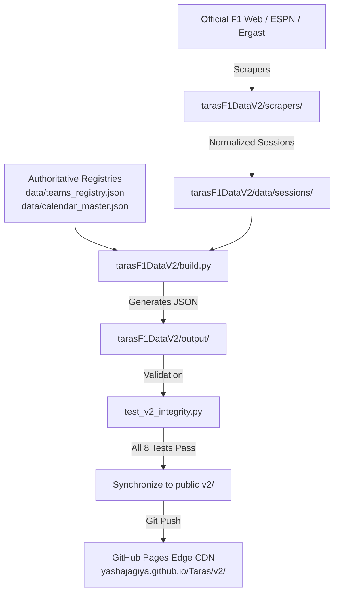

# 🏗️ Taras F1 API — Architecture & Extension Guide

This document outlines the **Clean, Standalone Static API Architecture** of the Taras F1 API dataset, explaining how both `v1` and `v2` operate as completely self-contained, independent modules.

---

## 🏛️ Core Architectural Principles

1. **100% Standalone Modules (`v1` and `v2`):**
   Both `v1/` and `v2/` are entirely self-contained. Each version includes its own scrapers, build engines, registries, and generated JSON endpoints. Neither relies on external shared pipeline directories.
2. **Edge-Cached Zero Compute:**
   No runtime application servers, virtual machines, or active databases. All API endpoints exist as pre-rendered JSON files served directly via GitHub's worldwide Fastly/Cloudflare CDN.
3. **Deterministic & Idempotent Builds:**
   Running `python v2/update.py --skip-scrape` builds the entire V2 dataset deterministically from registries and local caches without side-effects or network dependencies.
4. **Non-Destructive Storage:**
   Historical session results (`v2/results/round_{1..18}.json`) are preserved permanently. New rounds are appended without overwriting or destroying past race data.
5. **Backwards Compatibility:**
   Legacy `v1/` endpoints remain intact with their dedicated legacy scrapers, while `v2/` powers modern high-performance client applications.

---

## 📁 Repository Directory Structure

```text
TarasAPIstatic/
├── .github/
│   └── workflows/
│       └── update-f1.yml        # Weekly automated GitHub Actions scraper & deployer
├── index.html                   # Interactive Developer Portal & REST API Explorer for GitHub Pages
├── README.md                    # Primary repository overview and developer guide
├── update_v2.py                 # Root CLI shortcut delegating to v2/update.py
├── extract_rounds.py            # Root CLI shortcut delegating to v2/extract_rounds.py
│
├── v1/                          # 100% Self-Contained Legacy API Module
│   ├── README.md
│   ├── peerracepointdriver.py   # Legacy driver standings scraper & generator
│   ├── peerracepointcar.py      # Legacy constructor standings scraper & generator
│   ├── f1Info/                  # Historical driver & race metadata scrapers
│   ├── practice1/ ...           # Session-specific legacy folders & outputs
│   └── *.json                   # Legacy public JSON datasets
│
├── v2/                          # 100% Self-Contained Modern REST API Module
│   ├── README.md
│   ├── build.py                 # Master endpoint builder & aggregator
│   ├── update.py                # Pipeline orchestrator (scrape -> build -> verify -> git)
│   ├── extract_rounds.py        # Historical round extraction & normalization
│   ├── test_v2_integrity.py     # 8-suite automated integrity verification
│   ├── collectors/              # Data adapters (ESPN, Encyclopedia, Sessions)
│   ├── scrapers/                # Official Formula 1 session HTML parsers
│   ├── data/                    # Authoritative registries (teams, calendar, sessions)
│   ├── results/                 # Session classifications (latest & round_{1..18}.json)
│   ├── overview.json            # Public endpoint: Home screen in 1 request
│   ├── drivers.json             # Public endpoint: All 23 drivers with portraits & stats
│   ├── teams.json               # Public endpoint: All 11 constructors with cars & logos
│   ├── standings.json           # Public endpoint: Championship tables & round progression
│   ├── calendar.json            # Public endpoint: 24-race schedule & track maps
│   └── live.json                # Public endpoint: Live session status metadata
│
└── docs/                        # Complete technical documentation
    ├── API_REFERENCE.md         # Full REST API endpoint reference & schemas
    ├── ARCHITECTURE.md          # Architecture & extension guide (this document)
    ├── F1_DATA_SOURCES.md       # External data source catalog
    ├── PROJECT.md               # Product background & Taras ecosystem role
    └── mobile_app_specs/        # Specifications for the TARAS Jetpack Compose mobile app
```

---

## 🔄 Data Pipeline Flow



---

## 🛠️ How to Extend & Maintain

### 1. Adding a New Driver or Mid-Season Driver Swap
1. Open `tarasF1DataV2/data/teams_registry.json`.
2. Locate the team (e.g. `racing-bulls`).
3. Add or update the driver entry with `id`, `name`, `code`, `number`, and `portrait_url`.
4. Run `python update_v2.py --skip-scrape`.
5. The build engine automatically updates `v2/drivers.json`, `v2/teams.json`, and `v2/overview.json`.

### 2. Updating Constructor Renders or Colors
1. Open `tarasF1DataV2/build.py`.
2. Update the `OFFICIAL_TEAM_ASSETS` dictionary with new high-resolution URLs or ARGB hex color codes.
3. Run `python update_v2.py --skip-scrape`.

### 3. Scraping & Archiving a New Race Weekend
```bash
# Scrape specific round (e.g. Round 18 United States GP):
python update_v2.py --round 18

# Or extract all past rounds:
python tarasF1DataV2/extract_rounds.py --round 18 --build
```
This automatically scrapes FP1, FP2, FP3, Qualifying, Sprint, and Race classifications, writes `v2/results/round_18.json`, updates `v2/results/latest.json`, updates championship points in `v2/standings.json`, and runs the integrity verification suite.

### 4. Running Data Integrity Tests
```bash
python tarasF1DataV2/test_v2_integrity.py
```
Tests verified:
- [x] `overview.json` schema and leadership presence
- [x] All 23 drivers present with 16 season + 8 career metrics
- [x] All 11 constructors present with car renders and specs
- [x] Driver and Constructor standings with round points
- [x] Calendar coverage with valid dates and track maps
- [x] `results/latest.json` full weekend classification
- [x] Historical rounds 1 to 16 data retention
- [x] Specific Sprint weekend formatting (e.g. Round 17)

---

## 🌐 Deploying to GitHub Pages (`github.io`)

1. Commit and push the repository to GitHub:
   ```bash
   git add .
   git commit -m "Update F1 Static API dataset"
   git push origin main
   ```
2. In GitHub Repository Settings -> **Pages**:
   - **Source:** Deploy from a branch
   - **Branch:** `main` / `/ (root)`
3. Within ~60 seconds, all endpoints are live at `https://<username>.github.io/<repo>/v2/<endpoint>.json`.
